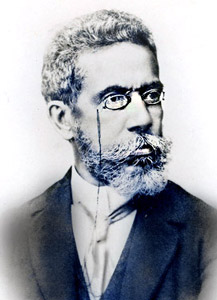

------------------------------------------------------------------------

::: {.callout-note appearance="minimal"}
**Sobre este Portfólio:** Este projeto aplica técnicas de *Web Scraping* e *Text Mining* (Mineração de Textos) em linguagem **R** (R CORE TEAM, 2026) utilizando o ecossistema **Tidyverse** (WICKHAM et al., 2019), visualização cartográfica interativa via **Leaflet** (CHENG; KARAMBELKAR; XIE, 2024) e publicação científica reproduzível em **Quarto** (ALLAIRE et al., 2024), sobre obras completas de Machado de Assis extraídas do **Wikisource** (FUNDAÇÃO WIKIMEDIA, 2026). Esta primeira seção estabelece o lastro histórico, biográfico e literário necessário para interpretar os padrões léxicos, estilísticos e emocionais revelados nas análises computacionais das abas seguintes.
:::

------------------------------------------------------------------------


# 1. Machado de Assis (Dataset)
## 1.1 Origens e Formação

:::::: columns
::: {.column width="68%"}
**Joaquim Maria Machado de Assis** nasceu em **21 de junho de 1839**, no **Morro do Livramento**, na cidade do Rio de Janeiro (então capital do Império do Brasil). Filho de Francisco José de Assis — pintor de paredes e dourador, filho de escravizados alforriados — e de Maria Leopoldina Machado da Câmara — lavadeira açoriana oriunda da Ilha de São Miguel —, Machado cresceu em uma família modesta, marcada pela mestiçagem e pela precariedade material (MASSA, 2009).

Órfão de mãe aos dez anos e de pai na adolescência, teve uma educação formal fragmentada e essencialmente autodidata. Não frequentou universidades nem colégios de elite da Corte; aprendeu os primeiros rudimentos de leitura em uma escola pública primária de São Cristóvão e aprofundou seus estudos por conta própria, frequentando gabinetes de leitura e aprendendo francês com uma padeira imigrante (Madame Gallot) e latim com o padre Silveira Sarmento (MASSA, 2009; BOSI, 1994).
:::

::: {.column width="4%"}
:::

::: {.column width="28%"}
{#fig-machado width="100%" fig-align="center"}
:::
::::::


```{r}
#| label: fig-mapa-machado
#| fig-cap: "Geografia afetiva e residencial de Machado de Assis no Rio de Janeiro (1839–1908). Elaborado em R com os pacotes leaflet (CHENG; KARAMBELKAR; XIE, 2024) e tibble (MÜLLER; WICKHAM, 2023)."
#| echo: false
#| warning: false
#| message: false

library(tibble)
library(leaflet)

pontos_machado <- tribble(
  ~local, ~descricao, ~lat, ~lng,
  "Morro do Livramento (Gamboa)", "Nascimento (1839) e infância na antiga chácara do Livramento.", -22.8981, -43.1925,
  "Rua do Ouvidor (Centro)", "Epicentro jornalístico, livraria Paula Brito e redações do Segundo Reinado.", -22.9035, -43.1772,
  "Rua Cosme Velho, nº 18", "Residência com Carolina (1884–1908), onde ganhou a alcunha de 'Bruxo do Cosme Velho'.", -22.9419, -43.2008
)

leaflet(pontos_machado) %>%
  addTiles() %>%
  fitBounds(lng1 = -43.208, lat1 = -22.948, lng2 = -43.170, lat2 = -22.892) %>%
  addCircleMarkers(
    lng = ~lng,
    lat = ~lat,
    radius = 8,
    color = "#2780e3",
    fillOpacity = 0.85,
    popup = ~paste0("<b>", local, "</b><br/>", descricao)
  )
```


Ao longo da vida, sua geografia afetiva e residencial concentrou-se na antiga Corte carioca:

-   **Morro do Livramento (atual bairro da Gamboa / Saúde)**: Local de seu nascimento e infância, próximo à zona portuária do Rio de Janeiro. A chácara onde nasceu (propriedade da madrinha, Maria José de Mendonça Barroso, viúva do senador Bento Barroso Pereira) deu lugar à urbanização portuária e ferroviária no início do século XX, mas o morro e a Igreja de Nossa Senhora do Livramento permanecem como marcos históricos da região.
-   **Centro e Lapa / Catete / Flamengo:** Na juventude e início da vida adulta, circulou intensamente pelas redações e livrarias da Rua do Ouvidor (epicentro intelectual e político do Segundo Reinado), residindo em pensões e casas nos bairros centrais e no Catete após seu casamento, em 1869, com a portuguesa Carolina Augusta Xavier de Novais.
-   **Cosme Velho (Rua Cosme Velho, nº 18):** Em 1884, mudou-se com Carolina para o chalé na Rua Cosme Velho, bairro arborizado aos pés do Corcovado, onde viveu até sua morte em 29 de setembro de 1908. Foi ali que ganhou a alcunha de "Bruxo do Cosme Velho" (popularizada pelo poeta Carlos Drummond de Andrade no poema A um bruxo, com amor, de 1958). A casa original foi demolida na década de 1960, mas o bairro conserva sua atmosfera histórica e abrigou por décadas instituições culturais em sua memória.

------------------------------------------------------------------------

## 1.2 Império, Escravidão e República

A vida de Machado de Assis (1839–1908) atravessa as transformações políticas e sociais mais profundas da história brasileira. Sua obra não é alienada da realidade nacional; ao contrário, utiliza a ironia e o distanciamento crítico para expor as contradições de uma sociedade patriarcal, escravocrata e estamental (SCHWARZ, 2000).

-   **O Segundo Reinado (1840–1889):** Machado cresceu e amadureceu intelectualmente sob o reinado de Dom Pedro II. A estabilidade política relativa da Corte contrastava com a economia baseada na monocultura cafeeira e no trabalho escravo.
-   **A Escravidão e o Processo Abolicionista:** Neto de escravizados libertos, Machado testemunhou todo o lento desmonte jurídico da escravidão no Brasil:
    -   **Lei Eusébio de Queirós (1850):** Proibiu o tráfico transatlântico de escravizados quando Machado tinha 11 anos.
    -   **Lei do Ventre Livre (1871):** Declarou livres os filhos de mulheres escravizadas nascidos a partir daquela data — lei que o próprio Machado, na condição de funcionário público do Ministério da Agricultura, ajudou a fiscalizar e aplicar administrativamente (CHALHOUB, 2003).
    -   **Lei dos Sexagenários (1885)** e **Lei Áurea (13 de maio de 1888):** Aboliu definitivamente a escravidão, assinada pela Princesa Isabel. Dias depois, em 19 de maio de 1888, Machado publicou uma célebre crônica na série Bons Dias! ironizando a hipocrisia dos antigos senhores que tentavam reescrever seu passado escravista (ASSIS, 1888).
-   **A Proclamação da República (1889) e a Primeira República:** Aos 50 anos, testemunhou a queda da monarquia liderada pelo Marechal Deodoro da Fonseca, a crise financeira do Encilhamento e os primeiros governos republicanos (Deodoro, Floriano Peixoto, Prudente de Moraes, Campos Sales e Rodrigues Alves) — contexto que serve de pano de fundo direto para romances como Esaú e Jacó (ASSIS, 1904) e Memorial de Aires (ASSIS, 1908).

------------------------------------------------------------------------

## 1.3 Trajetória Profissional e a Academia

Diferente de muitos escritores boêmios de sua geração, Machado de Assis construiu uma carreira sólida e disciplinada no serviço público e na imprensa, garantindo estabilidade financeira para dedicar-se à literatura.

### 1.3.1 Imprensa e Tipografia (1856–1897)

-   **Tipógrafo e Revisor:** niciou sua vida profissional em 1856 como aprendiz de tipógrafo na Imprensa Nacional (então Tipografia Nacional), sob a direção de Manuel Antônio de Almeida (autor de Memórias de um Sargento de Milícias), seu primeiro grande incentivador. Em seguida, atuou como revisor de provas na livraria e editora de Francisco de Paula Brito, figura central da cultura negra e editorial no Rio de Janeiro (MASSA, 2009).
-   **Jornalista e Cronista:** ngressou no jornalismo profissional no Correio Mercantil (1858) e no Diário do Rio de Janeiro (1860), onde cobriu debates do Senado e escreveu críticas teatrais e literárias. Ao longo de quatro décadas, colaborou com os principais periódicos do país, como A Semana Ilustrada, O Cruzeiro, A Estação e a Gazeta de Notícias.

------------------------------------------------------------------------

### 1.3.2 Carreira no Serviço Público (1867–1908)

-  Em **1867**, foi nomeado ajudante do diretor de publicação do *Diário Oficial*.
-  Em **1873**, ingressou como primeiro-oficial na Secretaria de Estado do Ministério da Agricultura, Comércio e Obras Públicas (pasta estratégica no Império, responsável tanto pela infraestrutura quanto pela fiscalização dos fundos de emancipação de escravos) (CHALHOUB, 2003).
-   Ascendeu por mérito técnico até alcançar o cargo de Diretor-Geral da Diretoria de Comércio (1889) e, posteriormente, Diretor-Geral de Contabilidade do Ministério da Indústria, Viação e Obras Públicas (1902), cargo equivalente hoje ao mais alto escalão técnico ministerial, no qual permaneceu até seu falecimento.

------------------------------------------------------------------------

### 1.3.3 A Fundação da Academia Brasileira de Letras (ABL)

Sem diplomas universitários, mas reconhecido unanimemente como o maior homem de letras do país, Machado de Assis liderou, ao lado de intelectuais como Lúcio de Mendonça, Joaquim Nabuco, Visconde de Taunay, Olavo Bilac e Rui Barbosa, a fundação da Academia Brasileira de Letras (ABL) em 20 de julho de 1897. Eleito por unanimidade seu primeiro presidente, ocupou a Cadeira nº 23 (cujo patrono escolhido por ele foi José de Alencar) e presidiu a instituição por mais de uma década, consolidando-a como a casa máxima da língua e da literatura no Brasil (BOSI, 1994).

------------------------------------------------------------------------

## 1.4 Escolas Literárias e a Virada Estética

A crítica literária divide a produção romanesca de Machado de Assis em duas grandes fases, refletindo sua evolução estética de um escritor alinhado às convenções de seu tempo para um revolucionário da narrativa moderna (CANDIDO, 1970; BOSI, 1994):


| Dimensão | Primeira Fase (1864–1878) | Segunda Fase (1881–1908) |
|:-----------------------|:-----------------------|:-----------------------|
| **Escola Literária** | **Romantismo** (com traços de transição e análise psicológica incipiente) | **Realismo Psicológico** (precursor do Modernismo e da metalinguagem) |
| **Foco Narrativo** | Enredos lineares, conflitos amorosos, ascensão social e moralismo familiar. | Crítica ácida à hipocrisia burguesa, pessimismo filosófico, ironia e ambiguidade. |
| **Narrador** | Onisciente tradicional em 3ª pessoa, confiável e convencional. | Narrador não confiável (em 1ª pessoa ou irônico), digressivo e interlocutor do leitor. |
| **Obras Representativas** | *Ressurreição*, *A Mão e a Luva*, *Helena*, *Iaiá Garcia*. | *Memórias Póstumas de Brás Cubas*, *Quincas Borba*, *Dom Casmurro*, *Esaú e Jacó*, *Memorial de Aires*. |

------------------------------------------------------------------------

## 1.5 Cronologia das Obras de Machado de Assis

Para situar os **7 livros selecionados no corpus deste estudo** (Helena, Memórias Póstumas de Brás Cubas, O Alienista, Quincas Borba, Dom Casmurro, Esaú e Jacó e Memorial de Aires) dentro do conjunto total da produção machadiana, apresenta-se abaixo o acervo digitalizado e as tabelas cronológicas das obras publicadas em vida por gênero literário.


### 1.5.1 Romances (Produção Integral)

| Ano | Título da Obra | Fase Literária | Status no Corpus deste Estudo |
|:------------------:|:-----------------|:-----------------|:-----------------|
| **1872** | *Ressurreição* | Primeira Fase (Romântica) | Não incluído (texto parcial no Wikisource) |
| **1874** | *A Mão e a Luva* | Primeira Fase (Romântica) | Não incluído (texto parcial no Wikisource) |
| **1876** | ***Helena*** | Primeira Fase (Romântica) | **Incluído (28 capítulos)** |
| **1878** | *Iaiá Garcia* | Primeira Fase (Romântica) | Não incluído (texto parcial no Wikisource) |
| **1881** | ***Memórias Póstumas de Brás Cubas*** | Segunda Fase (Realista) | **Incluído (160 capítulos)** |
| **1891** | ***Quincas Borba*** | Segunda Fase (Realista) | **Incluído (198 capítulos)** |
| **1899** | ***Dom Casmurro*** | Segunda Fase (Realista) | **Incluído (145 capítulos)** |
| **1904** | ***Esaú e Jacó*** | Segunda Fase (Realista) | **Incluído (122 capítulos)** |
| **1908** | ***Memorial de Aires*** | Segunda Fase (Realista) | **Incluído (161 capítulos)** |

------------------------------------------------------------------------

### 1.5.2 Coletâneas de Contos e Novelas

| Ano | Título da Obra | Destaques / Observações |
|:--------------------------:|:---------------------|:---------------------|
| **1870** | *Contos Fluminenses* | Primeira coletânea de narrativas curtas (*Miss Dollar*, *Luís Soares*). |
| **1873** | *Histórias da Meia-Noite* | Inclui *A Parasita Azul* e *Aurora sem Dia*. |
| **1882** | ***Papéis Avulsos*** | Contém a novela ***O Alienista*** (**incluída no corpus — 13 capítulos**), *Teoria do Medalhão* e *O Espelho*. |
| **1884** | *Histórias sem Data* | Inclui *A Igreja do Diabo*, *Noite de Almirante* e *Conto Alexandrino*. |
| **1896** | *Várias Histórias* | Inclui *A Cartomante*, *A Causa Secreta*, *Uns Braços* e *O Enfermeiro*. |
| **1899** | *Páginas Recolhidas* | Inclui *Missa do Galo* e *O Caso da Vara*. |
| **1906** | *Relíquias de Casa Velha* | Inclui *Pai contra Mãe* e textos memorialísticos. |

------------------------------------------------------------------------

### 1.5.3 Poesia, Teatro e Crítica

| Gênero | Ano | Obras Publicadas |
|:---------------------|:--------------------------:|:---------------------|
| **Poesia** | 1864–1901 | *Crisálidas* (1864), *Falenas* (1870), *Americanas* (1875), *Ocidentais* (em *Poesias Completas*, 1901). |
| **Teatro** | 1861–1881 | *Desencantos* (1861), *O Caminho da Porta* (1863), *O Protocolo* (1863), *Quase Ministro* (1864), *Os Deuses de Casaca* (1866), *Tu, só tu, puro amor* (1880). |
| **Crônicas** | 1859–1897 | Séries publicadas na imprensa e reunidas postumamente: *Balas de Estalo* (1883–1886), *Bons Dias!* (1888–1889) e *A Semana* (1892–1897). |

------------------------------------------------------------------------

## 1.6 Conexão com a Análise Computacional

A transição da **Primeira Fase** (representada neste corpus por *Helena*, de 1876) para a **Segunda Fase** (representada por *Memórias Póstumas*, *O Alienista*, *Quincas Borba*, *Dom Casmurro*, *Esaú e Jacó* e *Memorial de Aires*) levanta hipóteses literárias que serão testadas quantitativamente nas próximas seções:

1.  **Riqueza Vocabular e Sintaxe:** O estilo mais seco, elíptico e fragmentado dos romances realistas altera a diversidade léxica (`TTR` e `CTTR`) e a complexidade sintática em relação à prosa romântica de *Helena*?
2.  **Assinatura Temática:** Como termos centrais da filosofia machadiana — como *olhos*, *alma*, *morte*, *razão* e *loucura* — se distribuem ao longo das narrativas?
3.  **Polaridade Emocional:** O pessimismo e a ironia da fase realista se refletem em um saldo de sentimento mais negativo ou em maior volatilidade emocional entre capítulos?

Avance para a aba **Scraping & Pipeline** para acompanhar a arquitetura técnica de coleta e tratamento desses dados em **R**.


------------------------------------------------------------------------


